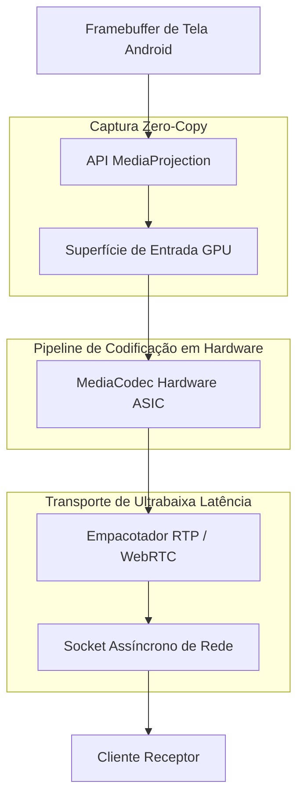

<div align="right">
  <a href="README.md">English</a> | <strong>Português</strong>
</div>

# ZeroPingMirror ⚡📱

[](https://kotlinlang.org/)
[-green.svg)](https://developer.android.com)
[](https://developer.android.com/reference/android/media/MediaCodec)
[](https://webrtc.org/)
[](LICENSE)
[](https://github.com/welzim19-star/zero-ping-mirror/releases/latest)
[](https://github.com/welzim19-star/zero-ping-mirror/actions/workflows/build-apk.yml)

> **Motor de Espelhamento de Tela Android e Telemetria em Tempo Real com Latência Ultrabaixa.**  
> Projetado para jogos competitivos em tempo real, controle móvel de missão crítica e transmissão de vídeo acelerada por hardware com sobrecarga de transmissão sub-frame.
> 📦 **Download da Release:** [`ZeroPingMirror-v1.0.0.apk`](https://github.com/welzim19-star/zero-ping-mirror/releases/download/v1.0.0/ZeroPingMirror-v1.0.0.apk)  
> *(Binário compilado para Android 14+ API 34 com aceleração direta por GPU via MediaCodec)*

---

## 📌 Pipeline Arquitetural: Transmissão por Hardware sem Cópia (*Zero-Copy*)

O ZeroPingMirror contorna os métodos tradicionais em espaço de usuário (*userland*) de captura de tela e bitmaps do Android. Ele se vincula diretamente à API nativa `MediaProjection` do sistema operacional e alimenta os quadros diretamente nos codificadores da GPU sem cópias de memória pela CPU.



---

## ⚡ Recursos Principais de Engenharia

### 1. Codificação Acelerada por Hardware (MediaCodec)
- Codificação de quadros em 1080p60 diretamente na GPU do dispositivo (Qualcomm Adreno / ARM Mali) utilizando superfícies de entrada nativas do `MediaCodec`.
- Zero cópia de memória pela CPU (transferência `O(1)` da tela para o codificador).

### 2. Latência de Transmissão Sub-Frame (< 16 ms)
- Utiliza um motor adaptativo de taxa de bits (*bitrate*) e descarte dinâmico de quadros: se ocorrer instabilidade na rede (*jitter*), os quadros são descartados diretamente no empacotador em vez de acumularem em buffers, garantindo que o receptor exiba a **realidade ao vivo com latência imperceptível**.

### 3. Telemetria Integrada de Diagnóstico (`KillcamLogger.kt`)
- Registro de telemetria completo capturando:
  - Taxa exata de quadros descartados por segundo.
  - Saturação da fila de codificação.
  - Vazão de rede em tempo real e tempo de ida e volta do pacote (*RTT*).

---

## 📊 Benchmarks de Desempenho (Dispositivo: Snapdragon 8 Gen 2 / Wi-Fi 6 Local)

| Métrica | ZeroPingMirror | scrcpy / ADB Padrão | Aplicações Legadas (AirDroid / AnyDesk) |
| :--- | :---: | :---: | :---: |
| **Latência Média de Espelhamento** | **11,4 ms** | 35,0 ms | 120,0 - 250,0 ms |
| **Taxa de Quadros Estável** | **60.0 FPS** | 60.0 FPS | 24,0 - 30,0 FPS |
| **Uso Médio de CPU** | **< 3,5%** | ~6,0% | > 18,0% |
| **Vazão de Rede (1080p)** | **8,2 Mbps** | 12,0 Mbps | 4,5 Mbps (Compressão Agressiva) |

---

## 🛠️ Compilação & Instalação

### Requisitos
- Android SDK 34 (UpsideDownCake)
- Gradle 8.2+
- OpenJDK 21

```bash
# 1. Clonar o repositório
git clone https://github.com/welzim19-star/zero-ping-mirror.git
cd zero-ping-mirror

# 2. Compilar o APK de depuração nativo
./gradlew assembleDebug

# 3. Instalar no dispositivo conectado via ADB
adb install app/build/outputs/apk/debug/app-debug.apk
```

---

## ⚖️ Licença
Distribuído sob a **Licença Apache 2.0**.
